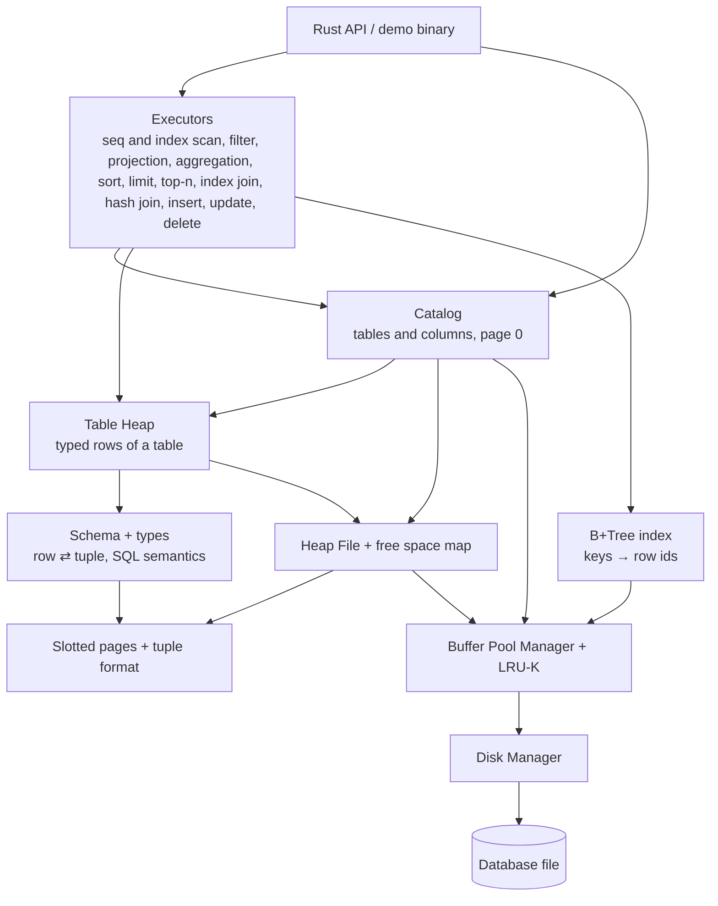

<p align="center">
  
</p>

# ferroDB

[](https://github.com/RodrigoGrz/ferro-db/actions/workflows/ci.yml)
[](LICENSE)

An educational relational database engine, built from scratch in Rust and inspired by the [CMU Database Group](https://db.cs.cmu.edu/)'s Database Systems course (15-445/645).

ferroDB exists so I can understand how a relational database works by implementing its internals myself: how pages reach the disk, how a buffer pool decides what stays in memory, how rows of different sizes share a page, and, later, how queries, indexes and transactions are built on top of that. The long-term goal is a small but real SQL database that a simple application can connect to.

It is **not** meant to compete with PostgreSQL, MySQL or SQLite, and it is **not production-ready**.

**Current status:** the storage engine, a typed table layer, a persistent catalog, a B+Tree index, query executors and an SQL lexer work and are tested (1,172 tests). Typed rows can be stored in tables that survive restarts and queried and changed through executors, from the Rust API. There are no SQL statements yet: the lexer turns SQL text into tokens, and the parser comes next. See the [roadmap](ROADMAP.md) for the full checklist.

## What works today

| Component | What it does |
|---|---|
| **Disk Manager** | Reads and writes fixed-size 8 KB pages in a single file, syncs every write to disk (`sync_data`), detects torn files. |
| **Buffer Pool Manager** | Caches pages in a fixed number of frames, with pin counts, dirty tracking, write-back, page allocation, and checksum and header validation on every read from disk. |
| **LRU-K replacer** | Chooses which unpinned page to evict (K = 2). |
| **Page format** | A 16-byte header on every page: page type, format version, CRC32 checksum and a reserved LSN; explicit little-endian serialization (the crate has no `unsafe` code). |
| **Slotted pages and RID** | Variable-size tuples inside a page behind stable slot ids, with tombstones and lazy compaction. A `Rid` (page + slot) addresses any row. |
| **Tuple format** | NULL bitmap, fixed and variable-width fields, strict validation of bytes read from disk. |
| **Heap File + free space map** | A table's rows across a linked list of pages, first-fit placement in O(log n), moves rows that outgrow their page. |
| **Data types** | `SMALLINT`, `INTEGER`, `BIGINT`, `REAL`, `DOUBLE PRECISION`, `VARCHAR(n)`, `BOOLEAN`, `DATE`, `TIMESTAMP` and `NULL`, with SQL semantics: parsing, casts and store assignment, overflow-checked arithmetic, `||`, comparisons as SQL values, three-valued `AND`/`OR`/`NOT` and PostgreSQL-compatible SQLSTATE codes. |
| **Schema** | Column definitions, `NOT NULL`, and typed row ⇄ tuple conversion with SQL assignment rules. |
| **Table Heap** | A table's rows as typed values: insert, get, update, delete and scan, validated by the schema before anything is written. |
| **Catalog** | Tables, columns and indexes persisted on disk and bootstrapped from page 0, loaded into memory on open; finds a table's rows and an index's tree by name, keeping one open handle each; creates and fills indexes. |
| **B+Tree index** | A unique index from keys of any type (text included) to row ids, with range scans; nodes of variable-size entries split, merge and redistribute by bytes, and a failed operation changes nothing. |
| **Executors** | Iterator-model executors over expressions with SQL semantics: sequential scan, index scan (points and ranges, in key order), values, filter (`WHERE` keeps TRUE only), projection, hash aggregation (`GROUP BY` with `COUNT`, `SUM`, `AVG`, `MIN`, `MAX`; `HAVING` as a filter), sort (several keys, `NULLS FIRST`/`LAST`), limit and offset, top-N with a bounded heap, index nested loop join (`INNER` and `LEFT`), hash join (`INNER`, `LEFT`, `RIGHT`, `FULL`), insert, update and delete. Writes keep the indexes in step and validate a whole statement before writing (a refused statement leaves no trace). |

**Partially there:**

- Queries and writes run through executors built in Rust, but there are no `INSERT`/`SELECT`/`UPDATE`/`DELETE` statements yet: the parser and the planner come later.
- Indexes are created through the catalog and kept in step by the executors; there is no `CREATE INDEX` statement yet, and no planner to choose an index scan.
- `NOT NULL` is enforced per column by the schema, but there is no DDL to declare it.
- Every page reserves an LSN for write-ahead logging, but there is no WAL yet.

**Planned (not implemented):** SQL parser, query planning, more joins (sort-merge join, the plain nested loop for any condition), more data types (`NUMERIC`), constraints, transactions and concurrency control, WAL and crash recovery, a client/server interface. The [roadmap](ROADMAP.md) has the complete list in order.

## Architecture



Every component above exists today. Dependencies only point downward (`catalog` → `table` → `types` → `storage`). [docs/architecture.md](docs/architecture.md) has the detailed diagram, including the planned layers, and explains how a row travels from a `Value` to a page on disk.

## Quick start

Requires Rust 1.98.1 (see [`.tool-versions`](.tool-versions)); no other dependencies.

```sh
git clone https://github.com/RodrigoGrz/ferro-db.git
cd ferro-db
cargo build
cargo test
```

`cargo run` runs a small end-to-end demo ([`src/main.rs`](src/main.rs)). It is a fixed program, not an interactive SQL shell:

1. Opens `data.db` in the **current directory**, creating the database if the file does not exist.
2. Creates the table `accounts (id INTEGER NOT NULL, age SMALLINT, balance BIGINT)` on the first run.
3. Inserts **one new row on every run** (every third row has a `NULL` age).
4. Prints the catalog and every row with its `Rid` as `(page, slot)`.

Because the demo adds a row each time and writes to the current directory, run it from an empty directory to reproduce the output below:

```sh
cargo build
mkdir -p /tmp/ferro-demo && cd /tmp/ferro-demo
/path/to/ferro-db/target/debug/ferro-db   # run it three times
```

Output captured from three consecutive runs in an empty directory (each run is a separate process, so the rows come back from disk):

```text
$ ferro-db
tables:
  accounts (id INTEGER NOT NULL, age SMALLINT, balance BIGINT)
rows of accounts:
  (3, 0) -> (1, 19, 1000)

$ ferro-db
tables:
  accounts (id INTEGER NOT NULL, age SMALLINT, balance BIGINT)
rows of accounts:
  (3, 0) -> (1, 19, 1000)
  (3, 1) -> (2, 20, 2000)

$ ferro-db
tables:
  accounts (id INTEGER NOT NULL, age SMALLINT, balance BIGINT)
rows of accounts:
  (3, 0) -> (1, 19, 1000)
  (3, 1) -> (2, 20, 2000)
  (3, 2) -> (3, NULL, 3000)
```

Page 0 holds the database header and pages 1–2 the catalog heaps, so the table's rows start on page 3. If an older `data.db` from a previous on-disk format is found, the demo stops with a message asking you to delete it.

## Testing

```sh
cargo test --all-targets   # 1,080 unit tests + 92 integration tests
```

The suite is the main way the implementation is verified:

- **Unit tests** in every module, covering boundaries and every error variant.
- **Integration tests** in [`tests/`](tests/), one file per component: data survives eviction with tiny buffer pools and reopening the file.
- **Corruption tests:** bytes changed on disk are detected by checksums and validation, never by a panic.
- **Randomized model tests:** thousands of random operations compared against a simple in-memory model (`HashMap`, `Vec`, `i128` arithmetic), with invariants checked along the way.
- **Injected failures:** a test-only hook makes the buffer pool fail in the middle of a heap, catalog or index operation, to check that nothing half-done becomes visible.

CI runs `cargo fmt --check`, `cargo clippy -D warnings` and `cargo test` on every push and pull request.

## Documentation

- [ROADMAP.md](ROADMAP.md): implementation checklist, with evidence for what is done
- [docs/architecture.md](docs/architecture.md): components, data flow, testing strategy, limitations
- [docs/storage-engine.md](docs/storage-engine.md): disk manager, buffer pool, LRU-K, page and tuple formats, heap file, free space management
- [docs/data-model.md](docs/data-model.md): integers, floats, VARCHAR, BOOLEAN, DATE, TIMESTAMP and NULL, schema, catalog, deviations from the SQL standard
- [docs/indexes.md](docs/indexes.md): the B+Tree, key encoding, node format, splits and merges
- [docs/execution.md](docs/execution.md): expressions, executors, two-phase writes and index maintenance
- [docs/sql.md](docs/sql.md): the SQL layer: the lexer (tokens, keywords, identifiers, literals, comments, syntax errors)
- [docs/decisions/](docs/decisions/README.md): architectural decision records
- [CONTRIBUTING.md](CONTRIBUTING.md): development workflow and conventions

## Limitations

- **No SQL yet.** Everything is driven through the Rust API.
- **Single-threaded.** No concurrent access, locks or transactions.
- **No crash safety.** Without a WAL, a crash can lose pages that were not yet written, and multi-page operations (moving an updated row, creating a table) are not atomic. Errors *inside* the process return without leaving half-applied changes in a page or in the buffer pool; multi-page operations fall back to a best-effort undo.
- **Few types:** integers, floats, `VARCHAR(n)`, `BOOLEAN`, `DATE`, `TIMESTAMP` and `NULL`; no `NUMERIC` yet. Text compares by bytes (no collations), and a value must fit in one page.
- **Unstable formats.** On-disk formats change between versions without migrations; database files are disposable.

## Acknowledgements

The design follows the material of the [CMU Database Group](https://db.cs.cmu.edu/)'s Database Systems course and its BusTub project. Any mistakes are mine.

## License

[MIT](LICENSE)
