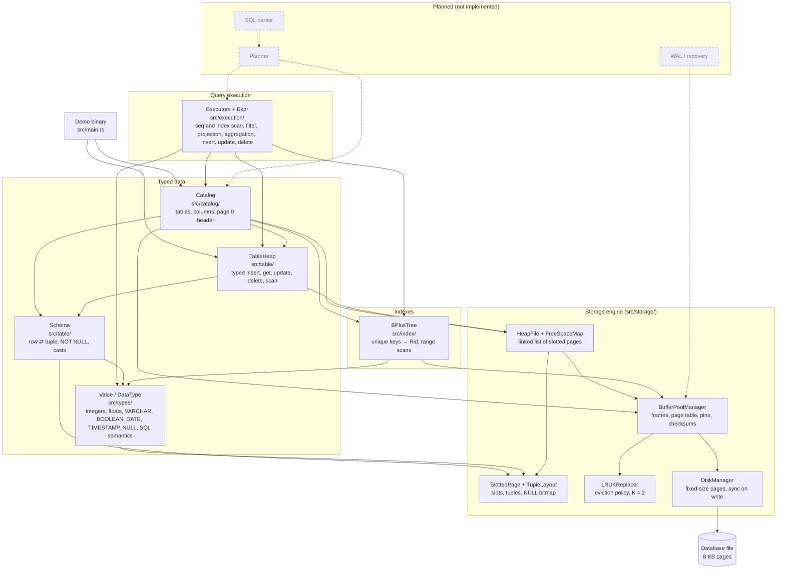

# Architecture

ferroDB is a single Rust crate (`ferro_db` library + a demo binary). The implemented part is the lower half of a relational database: everything needed to store typed rows in tables that survive restarts. There is no SQL layer yet.

This page explains the components and how data moves between them. Byte formats and invariants live in [storage-engine.md](storage-engine.md) and [data-model.md](data-model.md).

## Components

An arrow means "uses". Dashed nodes and arrows are planned work from the [roadmap](../ROADMAP.md), not current capabilities.

| Component | Responsibility | Does not |
|---|---|---|
| `DiskManager` | Read and write whole pages at `page_id × page_size`; detect torn files; `sync_data` on every write. | Cache, interpret page contents, verify checksums. |
| `BufferPoolManager` | Keep a fixed number of pages in memory; pin/unpin; write dirty pages back; stamp and verify checksums; validate page headers; allocate page ids. | Choose the victim itself (asks the replacer), survive crashes for unflushed pages, allow concurrent access. |
| `LRUKReplacer` | Pick the unpinned frame with the largest backward K-distance. | Know about pages or disk. |
| `SlottedPage` | Organize variable-size tuples inside one page behind stable slot ids. | Know which page a tuple should go to, or what a tuple contains. |
| `TupleLayout` / `TupleRef` | Encode and validate a row's bytes (NULL bitmap, fixed and variable fields). | Know SQL types. |
| `HeapFile` + `FreeSpaceMap` | Store a table's tuples across a linked list of pages; choose where inserts go; move tuples that grow out of their page. | Keep rows ordered or indexed. |
| `Value` / `DataType` | Integer, float, text, boolean, date, timestamp and NULL values with SQL semantics (parse, cast and assignment, arithmetic, `||`, comparisons as SQL values, three-valued logic). | Store anything. |
| `Schema` | Validate columns; convert a row of values to tuple bytes and back. | Know page sizes or table names. |
| `TableHeap` | A table's rows as values: validate and encode before writing, decode on read, typed scan. | Know table names or the catalog. |
| `Catalog` | Persist which tables and indexes exist, their columns, first data page and tree; bootstrap from page 0; create and fill indexes; keep one open `TableHeap` per table and one `BPlusTree` per index used. | Expose SQL, or update indexes when a table changes. |
| Executors (`SeqScan`, `IndexScan`, `Values`, `Filter`, `Projection`, `Aggregation`, `Insert`, `Delete`, `Update`) | Run a plan in the iterator model, one row per `next`; evaluate expressions with SQL semantics; group rows in a hash table and compute aggregates; write in two phases (read the child, validate the whole statement, write) keeping every index of the table in step. | Parse SQL, choose plans, or survive an I/O failure halfway through a write. |
| `BPlusTree` | Map unique keys of one type to `Rid`s in pages of the buffer pool; search, insert, remove and range scans; split, merge and redistribute nodes; reuse freed pages. | Know tables, columns or `NULL`; allow duplicate keys. |

**Layering rule.** Dependencies only point downward: `catalog` → `table` → `types` → `storage`, `catalog` → `index`, and `index` → `types`/`storage`. `storage` never imports an upper layer, so the storage formats stay independent of SQL types. `config.rs` (page size) and `serialization.rs` (little-endian codec) sit at the crate root because every layer uses them.

## How data moves

### Opening a database

1. `BufferPoolManager::new(pool_size, page_size, path)` opens (or creates) the file through the `DiskManager`.
2. `Catalog::open` fetches page 0:
   - all zeros (never written) → new database: create the tables heap and the columns heap, write the database header last;
   - a `DatabaseHeader` page → check the magic, walk both catalog heaps, rebuild every table's `Schema` in memory.
3. The first `Catalog::table_heap(name)` for a table opens its `TableHeap`: `HeapFile::open(first_page_id)` walks the table's page list and builds its in-memory free space map. The catalog keeps that handle and returns it on every later call.

### Inserting a row

1. `Catalog::table_heap(name)` returns the table's `TableHeap`, and the caller calls `TableHeap::insert(&[Value])`.
2. `Schema::encode_row(&[Value])` checks arity and `NOT NULL`, applies store assignment (`Value::assign`) to each value and produces tuple bytes through the `TupleLayout`. A rejected row stops here, before any page is touched.
3. `HeapFile::insert(bytes)` asks the free space map for the first page with room. If none fits, it allocates a page with `BufferPoolManager::new_page` and links it at the end of the list.
4. The page is fetched (pinned) from the buffer pool, `SlottedPage::insert` places the tuple and returns a slot id, and the page is unpinned as dirty.
5. The caller gets a `Rid { page_id, slot_id }`.
6. Nothing has reached the disk yet. The dirty page is written when its frame is evicted, when `flush_page` is called, or when the buffer pool is dropped. Each write stamps the CRC32 checksum and calls `sync_data`.

### Scanning a table

1. `TableHeap::scan` walks the heap's pages in order through `HeapFile::scan`, which yields each live tuple with its `Rid`.
2. `Schema::decode_row` turns each tuple back into values of the column types, without trusting the bytes. A tuple that does not decode is an error for that row, and the scan goes on.

### Reading a page from disk

1. `fetch_page(id)` checks the page table; a hit returns the frame without I/O.
2. On a miss, the `DiskManager` reads the page (all zeros if it was never written).
3. The buffer pool verifies the checksum and the header (type and format version). A failure returns an error and leaves the pool untouched.
4. A frame is taken from the free list or from the replacer's victim (written back first if dirty), and only then are the free list, replacer and page table updated.

### Running a query

1. A plan is a tree of executors (for example `Projection(Filter(SeqScan))`); `execute` pulls its root until it ends, passing the `ExecutionContext` (catalog and buffer pool) down on every call.
2. `SeqScan` asks `TableHeap::next_after(last_rid)` for one row at a time: the heap reads the page, copies the next live tuple, unpins the page and the schema decodes it.
3. `Filter` evaluates its predicate (`Expr::eval`) and passes the row on only when the result is TRUE; `Projection` computes its expressions over the row.

### Aggregating

1. On its first call, `Aggregation` pulls its child until it ends. For each row it evaluates the `GROUP BY` expressions, finds the group in a `HashMap` (or creates it, numbered by its arrival) and updates one accumulator per aggregate.
2. Then it turns each group into a row (the key, then each aggregate's result) and hands them out one per call, sorted by arrival, so in the order the groups first appeared. A `HAVING` is a `Filter` above it. See [execution.md](execution.md#aggregation).

### Reading through an index

1. On its first call, `IndexScan` evaluates its bounds, finds the index and its table in the catalog and converts each bound to the key's type; a bound that empties the range ends the scan without touching the tree.
2. Each call asks `BPlusTree::range(Excluded(last key), upper)` for its first entry: the tree goes down from the root to the leaf, copies it, unpins it and hands out the entry. The iterator is dropped, so no page stays pinned.
3. `TableHeap::get(rid)` fetches the row, and the scan remembers its key as the new cursor. Rows come out in key order.

### Changing rows

1. Insert, Update and Delete first read all of their child's rows.
2. They validate the whole statement: `TableHeap::prepare` applies the table's rules to each new row, and every unique index checks the new keys (`BPlusTree::check_key`, `get`, and repeats among the statement's rows). A refused statement stops here, with nothing written.
3. Only then do they write each row to the heap and each key to the indexes; an Update takes every moved index entry out before putting any back. See [execution.md](execution.md#writing-two-phases).

### Looking up a key in an index

1. `BPlusTree::get(&Value)` encodes the key into bytes whose order is the SQL order of the key type.
2. From the root, each internal node is read through the buffer pool, binary-searched for the child to follow and unpinned; each child must be one level below its parent.
3. In the leaf, a binary search finds the key and its `Rid`, which a caller can pass to `TableHeap::get`.
4. An insert or remove computes every page it changes in memory, pins them, encodes them and only then copies them into the frames, so a failure leaves the tree as it was ([indexes.md](indexes.md#failing-without-side-effects)).

## Testing strategy

Every module has unit tests next to the code; [`tests/`](../tests/) holds integration tests named `<layer>_<component>.rs`. Recurring kinds of tests, all present in the code today:

- **Boundaries:** empty, one element, exactly full, full + 1, maximum sizes, integer extremes.
- **Every error variant** is triggered at least once, usually with its message (and SQLSTATE in the upper layers).
- **Persistence:** data survives eviction with tiny pools (2–3 frames) and reopening the file.
- **Corruption:** bytes changed on disk are caught by the checksum or by validation, never by a panic.
- **Randomized model tests:** thousands of random operations compared with a simple in-memory model (`HashMap`, `Vec`, `i128` arithmetic), with invariants checked along the way. They use a small deterministic PRNG defined in the tests.
- **Injected failures:** a test-only hook in the buffer pool makes a fetch fail in the middle of a heap, catalog or index operation, to check that nothing half-done becomes visible.

## Limitations

These are verified properties of the current code, not bugs to be fixed in passing:

- **No SQL.** There is no parser or planner; queries are trees of executors built through the Rust API. `cargo run` is a fixed demo.
- **Single-threaded.** Every buffer pool operation takes `&mut self`; there are no latches, locks or transactions.
- **No crash atomicity.** There is no WAL. A dirty page lives only in memory until it is written, and pages are written in no particular order. Documented consequences: an update that moves a tuple is not atomic, a crash in the middle of `create_table` can leave orphan columns or a table without columns, and an I/O error while extending a heap can leave an unreachable page. The `LSN` field is reserved in every page header for this work.
- **No space reclamation across pages.** There is no `VACUUM`; empty pages stay in their heap (and are reused by it), and pages orphaned by failures are never reclaimed.
- **Limited types.** Only `SMALLINT`, `INTEGER`, `BIGINT`, `REAL`, `DOUBLE PRECISION`, `VARCHAR(n)`, `BOOLEAN`, `DATE`, `TIMESTAMP` and `NULL`. Text compares by UTF-8 bytes and a value must fit in one page. The catalog still uses its own record format instead of system tables.
- **No `DROP TABLE` and no constraints** other than per-column `NOT NULL`. Indexes are created by the catalog and kept in step by the executors only (not by writes through `TableHeap`), and hold unique keys of one column only.
- **Formats are not stable.** Page and catalog formats have changed during development without migrations; database files are disposable.
