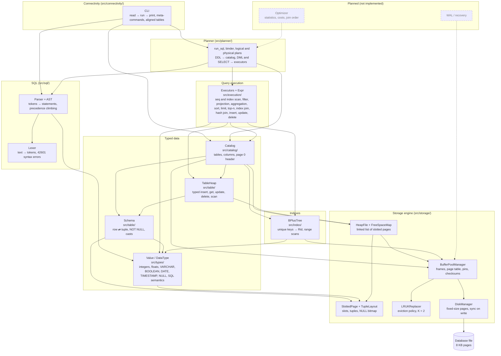

# Architecture

ferroDB is a single Rust crate (`ferro_db` library + the `ferro-db` command-line client). The implemented part is the lower half of a relational database: everything needed to store typed rows in tables that survive restarts, query and change them through executors, and the SQL layer: a lexer, a parser and a planner that runs `CREATE TABLE`, `CREATE UNIQUE INDEX`, `INSERT`, `UPDATE` and `DELETE`, and runs a `SELECT` through a validated logical plan and a physical plan of executors chosen by fixed rules, which `EXPLAIN` shows.

This page explains the components and how data moves between them. Byte formats and invariants live in [storage-engine.md](storage-engine.md) and [data-model.md](data-model.md).

## Components

An arrow means "uses". Dashed nodes and arrows are planned work from the [roadmap](../ROADMAP.md), not current capabilities.

| Component | Responsibility | Does not |
|---|---|---|
| `DiskManager` | Read and write whole pages at `page_id × page_size`; detect torn files; `sync_data` on every write. | Cache, interpret page contents, verify checksums. |
| `BufferPoolManager` | Keep a fixed number of pages in memory; pin/unpin; write dirty pages back; stamp and verify checksums; validate page headers; allocate page ids. | Choose the victim itself (asks the replacer), survive crashes for unflushed pages, allow concurrent access. |
| `LRUKReplacer` | Pick the unpinned frame with the largest backward K-distance. | Know about pages or disk. |
| `SlottedPage` | Organize variable-size tuples inside one page behind stable slot ids. | Know which page a tuple should go to, or what a tuple contains. |
| `TupleLayout` / `TupleRef` | Encode and validate a row's bytes (NULL bitmap, fixed and variable fields). | Know SQL types. |
| `HeapFile` + `FreeSpaceMap` | Store a table's tuples across a linked list of pages; choose where inserts go; move tuples that grow out of their page. | Keep rows ordered or indexed. |
| `Value` / `DataType` | Integer, float, text, boolean, date, timestamp and NULL values with SQL semantics (parse, cast and assignment, arithmetic, `||`, comparisons as SQL values, three-valued logic). | Store anything. |
| `Schema` | Validate columns; convert a row of values to tuple bytes and back. | Know page sizes or table names. |
| `TableHeap` | A table's rows as values: validate and encode before writing, decode on read, typed scan. | Know table names or the catalog. |
| `Catalog` | Persist which tables and indexes exist, their columns, first data page and tree; bootstrap from page 0; create and fill indexes; keep one open `TableHeap` per table and one `BPlusTree` per index used. | Expose SQL, or update indexes when a table changes. |
| Lexer (`tokenize`) | Turn the text of a statement into tokens with their byte spans: words folded to lowercase and marked as keywords, quoted identifiers, strings, numbers as written, operators; skip whitespace and nested comments; report syntax errors (`42601`) at a character position. | Parse statements, check names against the catalog, or depend on any other layer. |
| Parser and AST (`parse`) | Turn tokens into statements (`SELECT`, `CREATE TABLE`, `CREATE INDEX`, `INSERT`, `UPDATE`, `DELETE`, `EXPLAIN [LOGICAL] SELECT`) by recursive descent: projection, joins, `WHERE`, `GROUP BY`, `HAVING`, `ORDER BY`, `LIMIT`/`OFFSET`/`FETCH`, expressions by precedence climbing; decide which keywords are reserved; print the AST back as canonical SQL. | Resolve names or types against the catalog, run anything, or parse other statements yet. |
| CLI (`ferro-db`, `connectivity::cli::run`) | Open a database file; gather lines into complete commands with the lexer; run each statement through the planner and print its rows as an aligned table, its command tag or its error with the SQLSTATE; answer `\d`, `\i`, `\?`, `\q`; write every dirty page after each typed command and at the end of a script. | Talk over a network, edit lines, or make a command atomic (no WAL). |
| Planner (`run_sql`, `plan_select`, `plan_physical`) | Parse a whole text, then run each statement: bind names to column positions and literals to typed values, run DDL against the catalog and DML through a fixed plan of executors; turn a `SELECT` into a logical plan (scope of the `FROM`, grouping rules, `ORDER BY` by position, name or expression), push its filters down, then turn it into executors by fixed rules (hash keys, index joins, index scans for an equality, `TopN`), run it and give back its rows; print either plan for `EXPLAIN`; report each outcome like a command tag. | Choose plans by cost or join order, or undo the statements before a failure (no transactions). |
| Executors (`SeqScan`, `IndexScan`, `Values`, `Filter`, `Projection`, `Aggregation`, `Sort`, `Limit`, `TopN`, `IndexNestedLoopJoin`, `HashJoin`, `Insert`, `Delete`, `Update`) | Run a plan in the iterator model, one row per `next`; evaluate expressions with SQL semantics; group rows in a hash table and compute aggregates; sort rows in memory and cut them with `LIMIT`/`OFFSET`; join two tables through an index of the inner one or an in-memory hash table; write in two phases (read the child, validate the whole statement, write) keeping every index of the table in step. | Parse SQL, choose plans, or survive an I/O failure halfway through a write. |
| `BPlusTree` | Map unique keys of one type to `Rid`s in pages of the buffer pool; search, insert, remove and range scans; split, merge and redistribute nodes; reuse freed pages. | Know tables, columns or `NULL`; allow duplicate keys. |

**Layering rule.** Dependencies only point downward: `catalog` → `table` → `types` → `storage`, `catalog` → `index`, and `index` → `types`/`storage`. `storage` never imports an upper layer, so the storage formats stay independent of SQL types. `config.rs` (page size) and `serialization.rs` (little-endian codec) sit at the crate root because every layer uses them.

## How data moves

### Opening a database

1. `BufferPoolManager::new(pool_size, page_size, path)` opens (or creates) the file through the `DiskManager`.
2. `Catalog::open` fetches page 0:
   - all zeros (never written) → new database: create the tables heap and the columns heap, write the database header last;
   - a `DatabaseHeader` page → check the magic, walk both catalog heaps, rebuild every table's `Schema` in memory.
3. The first `Catalog::table_heap(name)` for a table opens its `TableHeap`: `HeapFile::open(first_page_id)` walks the table's page list and builds its in-memory free space map. The catalog keeps that handle and returns it on every later call.

### Inserting a row

1. `Catalog::table_heap(name)` returns the table's `TableHeap`, and the caller calls `TableHeap::insert(&[Value])`.
2. `Schema::encode_row(&[Value])` checks arity and `NOT NULL`, applies store assignment (`Value::assign`) to each value and produces tuple bytes through the `TupleLayout`. A rejected row stops here, before any page is touched.
3. `HeapFile::insert(bytes)` asks the free space map for the first page with room. If none fits, it allocates a page with `BufferPoolManager::new_page` and links it at the end of the list.
4. The page is fetched (pinned) from the buffer pool, `SlottedPage::insert` places the tuple and returns a slot id, and the page is unpinned as dirty.
5. The caller gets a `Rid { page_id, slot_id }`.
6. Nothing has reached the disk yet. The dirty page is written when its frame is evicted, when `flush_page` is called, or when the buffer pool is dropped. Each write stamps the CRC32 checksum and calls `sync_data`.

### Scanning a table

1. `TableHeap::scan` walks the heap's pages in order through `HeapFile::scan`, which yields each live tuple with its `Rid`.
2. `Schema::decode_row` turns each tuple back into values of the column types, without trusting the bytes. A tuple that does not decode is an error for that row, and the scan goes on.

### Reading a page from disk

1. `fetch_page(id)` checks the page table; a hit returns the frame without I/O.
2. On a miss, the `DiskManager` reads the page (all zeros if it was never written).
3. The buffer pool verifies the checksum and the header (type and format version). A failure returns an error and leaves the pool untouched.
4. A frame is taken from the free list or from the replacer's victim (written back first if dirty), and only then are the free list, replacer and page table updated.

### Lexing a statement

1. `tokenize` walks the text one character at a time (never off a character boundary), skipping whitespace, `--` comments and nested `/* */` comments.
2. The first character of each token decides its kind: a letter or `_` starts a word (folded to lowercase, then looked up in the sorted keyword table), `"` a quoted identifier, `'` a string, a digit (or a dot before one) a number, anything else an operator or punctuation mark.
3. Each token keeps the byte span of its source; the first problem stops the lexer with a `SqlError` at its character position. See [sql.md](sql.md).

### Parsing a statement

1. `parse` lexes the whole text, then reads statements separated by `;`.
2. `select` reads the clauses in their fixed order, each with its own function; `FROM` reads tables and joins left to right, a comma being a `CROSS JOIN`.
3. `expression_from(min)` reads an operand and then every operator that binds at least as tightly as `min`, its right side one level tighter, so precedence and left associativity come from one table; comparisons refuse a second comparison.
4. The result is an AST with names and literal text; the first problem stops the parser with a `SqlError` at the position of its token. See [sql.md](sql.md#parser).

### Running a statement

1. `run_sql` parses the whole text first; a syntax error runs nothing.
2. For each statement, the binder resolves the table in the catalog, turns column names into positions and literals into typed values (`-9223372036854775808` a `BIGINT`, `1.5` a `DOUBLE PRECISION`), and rewrites `BETWEEN` and `IN` into comparisons.
3. DDL goes to the catalog (`create_table`, `create_index`); DML builds `Insert(Values)`, `Update(Filter(SeqScan))` or `Delete(Filter(SeqScan))` and pulls it, the executors validating the whole statement before writing.
4. Each statement returns its outcome (`Insert(3)`, `Update(2)`…); the first failure stops the rest, and the statements before it stay done. See [planner.md](planner.md).

### Planning a SELECT

1. `plan_select` reads the `FROM`: each table becomes a `Scan` with its scope (its visible name and columns at an offset of the row), each join a `Join` whose `ON` binds over its two sides only.
2. `WHERE` binds over the whole scope. If the query is grouped (`GROUP BY`, `HAVING` or an aggregate), the select list, `HAVING` and `ORDER BY` bind in the binder's grouped mode, which turns aggregates and group expressions into columns of the grouped row and refuses any other column (`42803`); then the `Aggregate` node is built with every aggregate found.
3. `ORDER BY` items become sort keys by position, output name or expression over the rows before the projection; `LIMIT` and `OFFSET` bind over no columns.
4. The plan is assembled as `Scan/Join → Filter → Aggregate → Filter → Sort → Limit → Project`; `EXPLAIN LOGICAL` prints it one node per line with the columns by name. See [planner.md](planner.md#planning-a-select).

### Running a SELECT

1. `plan_physical` first pushes the filters down (`push_down_filters`): each conjunct of a `WHERE` or an `ON` goes down to the table it reads, or into the `ON` of the inner join whose two tables it compares, never down the padded side of an outer join nor below an `Aggregate`, `Sort`, `Limit` or `Project`.
2. It translates the rewritten plan node by node: a `Scan` under a `Filter` with `column = literal` on an indexed column becomes an `IndexScan`; a join's equalities between its two sides become hash keys, and an `IndexNestedLoopJoin` replaces the `HashJoin` when the right table has an index on a key's column (for `INNER` and `LEFT`, with a key type that converts to the index's); `Sort` with a counted `Limit` becomes `TopN`.
3. An index is used only when its key converts without an error (`converts_to_key`), so the choice never changes the rows of a query whose expressions do not fail; an expression that fails on some rows can fail in one plan and not another, since the plan decides which rows it is evaluated on.
4. `into_executor` builds the tree of executors, `execute` pulls its root to the end, and `run_sql` returns `Rows` with the output names; `EXPLAIN` prints the physical plan. See [planner.md](planner.md#physical-plan).

### A CLI session

1. `ferro-db FILE` opens the buffer pool and the catalog (`Session::open`) and reads standard input, with prompts only from a terminal.
2. Lines join a buffer until the lexer reads it whole with a `;` as its last token; a `;` in a string or a comment does not count, and a line starting with `\` is a meta-command.
3. The text is parsed, and each statement runs through `run_statement` and is printed at once: rows as an aligned table, other outcomes as command tags, errors with their SQLSTATE (the first one stops the rest of the text).
4. `flush_all` writes every dirty page after each typed command, so what the screen showed as done survives a killed process; a script is written once, at its end. See [connectivity.md](connectivity.md).

### Running a query

1. A plan is a tree of executors (for example `Projection(Filter(SeqScan))`); `execute` pulls its root until it ends, passing the `ExecutionContext` (catalog and buffer pool) down on every call.
2. `SeqScan` asks `TableHeap::next_after(last_rid)` for one row at a time: the heap reads the page, copies the next live tuple, unpins the page and the schema decodes it.
3. `Filter` evaluates its predicate (`Expr::eval`) and passes the row on only when the result is TRUE; `Projection` computes its expressions over the row.

### Aggregating

1. On its first call, `Aggregation` pulls its child until it ends. For each row it evaluates the `GROUP BY` expressions, finds the group in a `HashMap` (or creates it, numbered by its arrival) and updates one accumulator per aggregate.
2. Then it turns each group into a row (the key, then each aggregate's result) and hands them out one per call, sorted by arrival, so in the order the groups first appeared. A `HAVING` is a `Filter` above it. See [execution.md](execution.md#aggregation).

### Joining by hashing

1. On its first call, `HashJoin` reads its whole right input: each row is checked against the declared width, its keys are evaluated and normalized (`1 = 1.0`, a `DATE` as its midnight), and it goes into the bucket of its key, or aside when a key is `NULL`.
2. Each row of the left input is checked, its keys are normalized the same way, and the rows of its bucket form the joined rows that pass the residual predicate, marking those right rows as matched; a left row without any is padded with `NULL`s in `LEFT` and `FULL`.
3. When the left input ends, `RIGHT` and `FULL` hand out the right rows never matched, in input order, padded with `NULL`s on the left. See [execution.md](execution.md#hash-join).

### Joining through an index

1. On its first call, `IndexNestedLoopJoin` finds the index and its table in the catalog: the table's name, the key type and its number of columns.
2. For each row of its outer child it evaluates the join key and converts it to the key type as an `IndexScan::point` bound (`key_bounds::point_key`); a `NULL` key, or one the key type rounds or cannot hold, matches nothing.
3. `BPlusTree::range([key, key])` gives the `Rid`s and `TableHeap::get` the inner rows, within the call, so no page stays pinned; each joined row (outer values, then inner values) passes the residual predicate or is dropped.
4. The matches come out one per call; in a `LEFT` join, an outer row without any comes out padded with `NULL`s. See [execution.md](execution.md#index-nested-loop-join).

### Sorting and limiting

1. On its first call, `Sort` pulls its child until it ends, computes each row's key (the `ORDER BY` expressions, each with its direction and `NULL` position) and sorts the rows stably in memory; then it hands them out one per call. See [execution.md](execution.md#sort-limit-and-topn).
2. `Limit` evaluates its count and offset before pulling anything, skips `offset` rows and passes on at most `count`; after that it never pulls its child again, so the scans below it stop early.
3. `TopN` reads its child like `Sort` but keeps only the best `offset + count` rows in a bounded heap, then sorts them, skips `offset` and hands out the rest.

### Reading through an index

1. On its first call, `IndexScan` evaluates its bounds, finds the index and its table in the catalog and converts each bound to the key's type; a bound that empties the range ends the scan without touching the tree.
2. Each call asks `BPlusTree::range(Excluded(last key), upper)` for its first entry: the tree goes down from the root to the leaf, copies it, unpins it and hands out the entry. The iterator is dropped, so no page stays pinned.
3. `TableHeap::get(rid)` fetches the row, and the scan remembers its key as the new cursor. Rows come out in key order.

### Changing rows

1. Insert, Update and Delete first read all of their child's rows.
2. They validate the whole statement: `TableHeap::prepare` applies the table's rules to each new row, and every unique index checks the new keys (`BPlusTree::check_key`, `get`, and repeats among the statement's rows). A refused statement stops here, with nothing written.
3. Only then do they write each row to the heap and each key to the indexes; an Update takes every moved index entry out before putting any back. See [execution.md](execution.md#writing-two-phases).

### Looking up a key in an index

1. `BPlusTree::get(&Value)` encodes the key into bytes whose order is the SQL order of the key type.
2. From the root, each internal node is read through the buffer pool, binary-searched for the child to follow and unpinned; each child must be one level below its parent.
3. In the leaf, a binary search finds the key and its `Rid`, which a caller can pass to `TableHeap::get`.
4. An insert or remove computes every page it changes in memory, pins them, encodes them and only then copies them into the frames, so a failure leaves the tree as it was ([indexes.md](indexes.md#failing-without-side-effects)).

## Testing strategy

Every module has unit tests next to the code; [`tests/`](../tests/) holds integration tests named `<layer>_<component>.rs`. Recurring kinds of tests, all present in the code today:

- **Boundaries:** empty, one element, exactly full, full + 1, maximum sizes, integer extremes.
- **Every error variant** is triggered at least once, usually with its message (and SQLSTATE in the upper layers).
- **Persistence:** data survives eviction with tiny pools (2–3 frames) and reopening the file.
- **Corruption:** bytes changed on disk are caught by the checksum or by validation, never by a panic.
- **Randomized model tests:** thousands of random operations compared with a simple in-memory model (`HashMap`, `Vec`, `i128` arithmetic), with invariants checked along the way. They use a small deterministic PRNG defined in the tests.
- **Injected failures:** a test-only hook in the buffer pool makes a fetch fail in the middle of a heap, catalog or index operation, to check that nothing half-done becomes visible.

## Limitations

These are verified properties of the current code, not bugs to be fixed in passing:

- **Plans by rule, not by cost.** `SELECT` runs through `run_sql`, with executors chosen by fixed rules; there are no statistics, a filter goes down to its table but joins run in the order written. The result is collected in memory.
- **Single-threaded.** Every buffer pool operation takes `&mut self`; there are no latches, locks or transactions.
- **No crash atomicity.** There is no WAL. A dirty page lives only in memory until it is written, and pages are written in no particular order. Documented consequences: an update that moves a tuple is not atomic, a crash in the middle of `create_table` can leave orphan columns or a table without columns, and an I/O error while extending a heap can leave an unreachable page. The `LSN` field is reserved in every page header for this work.
- **No space reclamation across pages.** There is no `VACUUM`; empty pages stay in their heap (and are reused by it), and pages orphaned by failures are never reclaimed.
- **Limited types.** Only `SMALLINT`, `INTEGER`, `BIGINT`, `REAL`, `DOUBLE PRECISION`, `VARCHAR(n)`, `BOOLEAN`, `DATE`, `TIMESTAMP` and `NULL`. Text compares by UTF-8 bytes and a value must fit in one page. The catalog still uses its own record format instead of system tables.
- **No `DROP TABLE` and no constraints** other than per-column `NOT NULL`. Indexes are created by the catalog and kept in step by the executors only (not by writes through `TableHeap`), and hold unique keys of one column only.
- **Formats are not stable.** Page and catalog formats have changed during development without migrations; database files are disposable.
